# LAPORAN PRAKTIKUM PEMROGRAMAN BERBASIS OBJEK

| Informasi Praktikan | Keterangan |
|---|---|
| **Nama** | Khaira Rahma Aprilliani|
| **NPM** | 4525210108 |
| **Kelas** | A |
| **Mata Kuliah** | Pemrograman Berbasis Objek (PBO) |
| **Pertemuan** | [07] - [Relasi Objek dan UML Class Diagram] |
| **Tanggal** | [15-10-2026] |

## Pertemuan 7 - Komposisi dan Agregasi


Studi kasus **perpustakaan** dan **jurusan** dalam dua bahasa, **Java** dan **PHP**, untuk membedakan dua jenis relasi "memiliki":

| | **Komposisi** | **Agregasi** |
|---|---|---|
| Contoh | `Buku` memiliki `Bab` | `Jurusan` memiliki `Mahasiswa` |
| Objek bagian dibuat | **di dalam** induk | **di luar**, lalu diserahkan ke induk |
| Constructor/method yang menerima objek bagian dari luar | **tidak ada** | **ada** (`daftarkan(Mahasiswa)`) |
| Kalau induk dihapus | bagian ikut hilang | bagian **tetap hidup** |
| Getter | mengembalikan **salinan tak-berubah** | mengembalikan salinan tak-berubah |

Tiga ciri yang membuat sebuah relasi benar-benar **komposisi** (dari komentar di `Buku.java`):

1. Tidak ada constructor atau method yang **menerima** objek bagian dari luar
2. Objek bagian **dibuat di dalam** induk
3. Getter mengembalikan **salinan** yang tidak bisa diubah

---

# Bagian Java

## File Buku.java (Komposisi)

### Sebelum

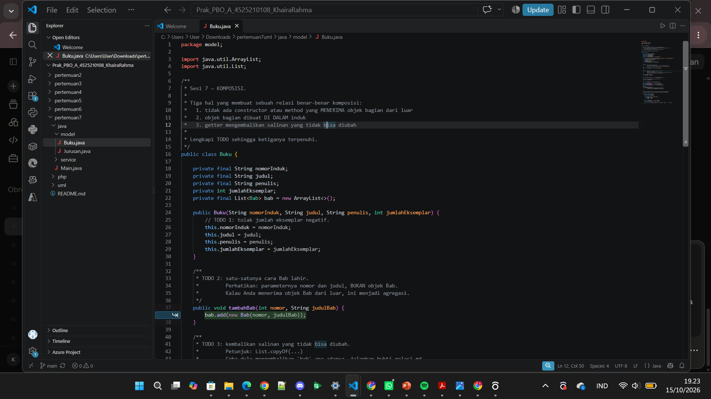

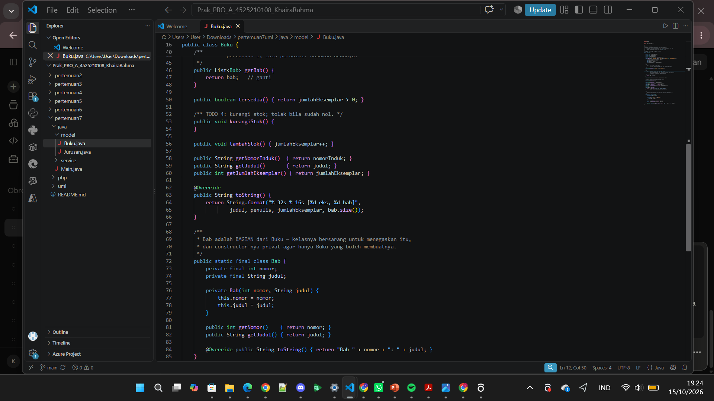

**Yang diminta:**

- **TODO 1**: constructor menolak jumlah eksemplar negatif.
- **TODO 2**: `tambahBab(int nomor, String judulBab)` adalah **satu-satunya cara `Bab` lahir**. Parameternya nomor dan judul, **bukan objek `Bab`**. Kalau menerima objek `Bab` dari luar, hubungannya menjadi agregasi.
- **TODO 3**: `getBab()` mengembalikan salinan yang tidak bisa diubah. Petunjuk: `List.copyOf(...)`. Coba dulu mengembalikan `bab` apa adanya, jalankan percobaan 1 di `bukti-relasi.md`, lalu perbaiki dan rasakan bedanya.
- **TODO 4**: `kurangiStok()` mengurangi stok dan menolak bila sudah nol.

**Kondisi kode awal:**

- Properti `nomorInduk`, `judul`, `penulis` bertipe `private final`, ditambah `jumlahEksemplar` dan `private final List<Bab> bab = new ArrayList<>()`.
- Constructor belum punya validasi, `getBab()` masih `return bab;`, dan `kurangiStok()` masih kosong.
- `Bab` adalah **kelas bersarang** (`public static final class Bab`) dengan **constructor `private`**, sehingga hanya `Buku` yang boleh membuatnya.

### Setelah

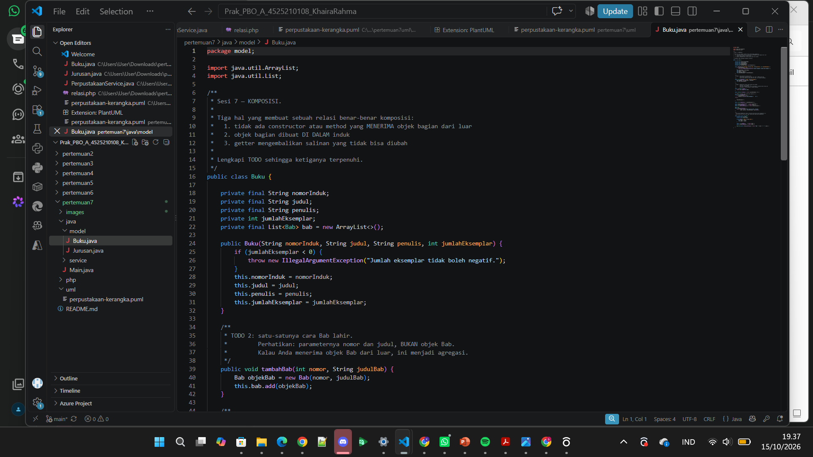

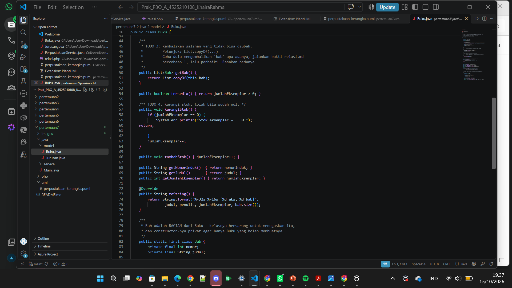

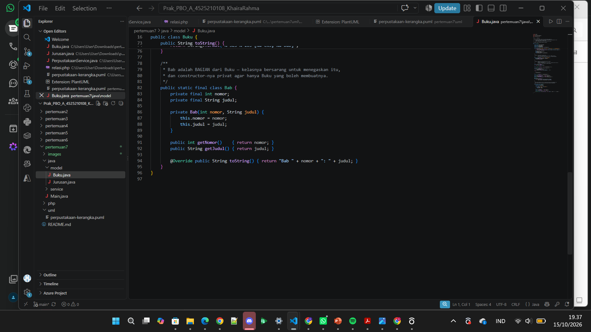

**Penjelasan kode:**

1. **Validasi (TODO 1).** `if (jumlahEksemplar < 0)` melempar `IllegalArgumentException("Jumlah eksemplar tidak boleh negatif.")`.
2. **`tambahBab()` (TODO 2).** Method menerima `nomor` dan `judulBab`, lalu membuat objeknya sendiri: `Bab objekBab = new Bab(nomor, judulBab); this.bab.add(objekBab);`. Tidak ada jalan bagi kode luar untuk menyerahkan objek `Bab`, dan itulah komposisi.
3. **`getBab()` (TODO 3).** `return List.copyOf(this.bab);` mengembalikan salinan tak-berubah. Pemanggil tidak bisa menambah atau menghapus bab milik `Buku` lewat hasil `getBab()`. Mencobanya melempar `UnsupportedOperationException`.
4. **`kurangiStok()` (TODO 4).** Kalau `jumlahEksemplar == 0`, method mencetak `"Stok eksemplar = 0."` ke `System.err` lalu `return`, sehingga stok tidak berkurang di bawah nol. Selain itu `jumlahEksemplar--`.
5. **Kelas bersarang `Bab` tetap `private` constructor-nya.** Kode di luar `Buku` yang mencoba `new Buku.Bab(1, "x")` ditolak kompilator dengan pesan `Bab(int,String) has private access in Bab`.

---

## File Jurusan.java (Agregasi)

### Sebelum

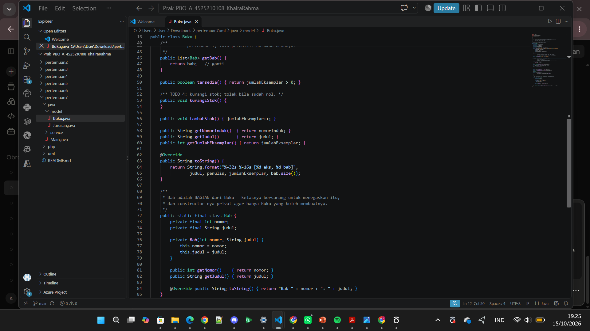

**Yang diminta:**

- **TODO 1**: `daftarkan(Mahasiswa m)` menerima objek `Mahasiswa` **dari luar**, inilah tanda agregasi. Tolak `null`, dan jangan menambahkan yang sudah terdaftar.
- **TODO 2**: `keluarkan(Mahasiswa m)` melepaskan mahasiswa dari jurusan. Objeknya **tetap hidup** di luar sana.
- **TODO 3**: `getMahasiswa()` mengembalikan salinan tak-berubah.

**Kondisi kode awal:** `daftarkan()` dan `keluarkan()` masih kosong, dan `getMahasiswa()` masih `return mahasiswa;`. Kelas bersarang `Mahasiswa` memiliki **constructor `public`** (komentarnya: "bisa dibuat di luar, bandingkan dengan `Buku.Bab`").

### Setelah

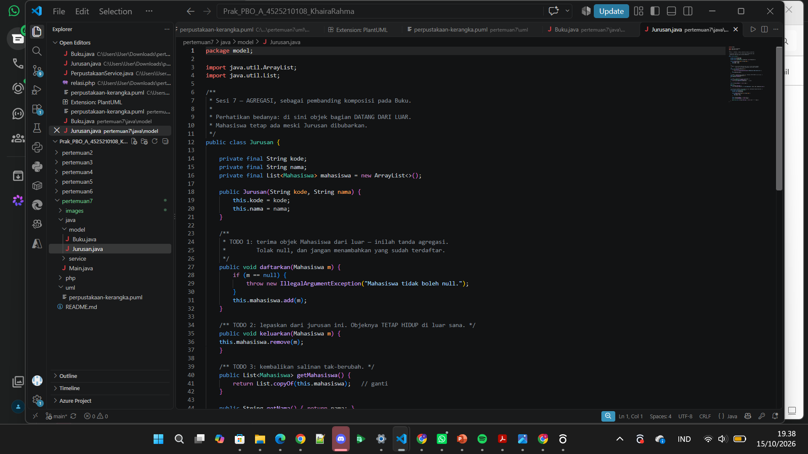

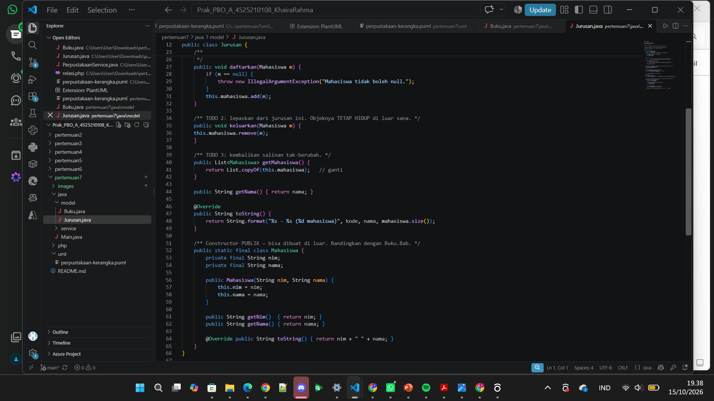

**Penjelasan kode:**

1. **`daftarkan()` (TODO 1).** Kalau `m == null`, melempar `IllegalArgumentException("Mahasiswa tidak boleh null.")`. Selebihnya `this.mahasiswa.add(m);`. Objek `Mahasiswa` dibuat **di luar** `Jurusan`, lalu diserahkan.
2. **`keluarkan()` (TODO 2).** `this.mahasiswa.remove(m);` hanya melepas referensi dari daftar jurusan. Objek `Mahasiswa` itu sendiri tidak dihapus dan tetap bisa dipakai di luar.
3. **`getMahasiswa()` (TODO 3).** `return List.copyOf(this.mahasiswa);`.
4. **Perbandingan dengan komposisi.** Constructor `Mahasiswa` itu `public`, jadi siapa pun bisa membuatnya. Itulah beda dengan `Buku.Bab` yang constructor-nya `private`.

---

## File PerpustakaanService.java

### Sebelum

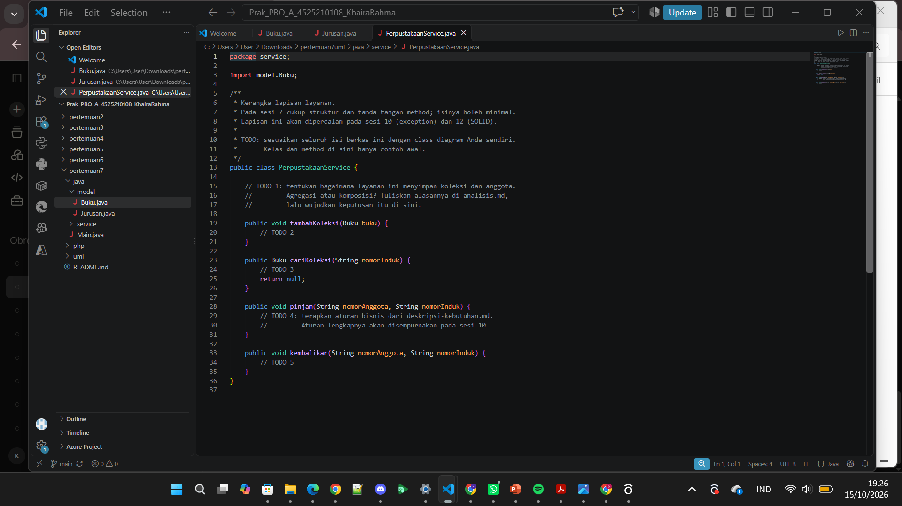

**Yang diminta:**

- Kerangka lapisan layanan. Pada sesi 7 cukup struktur dan tanda tangan method, dan isinya boleh minimal. Lapisan ini akan diperdalam pada sesi 10 (exception) dan sesi 12 (SOLID).
- **TODO 1**: tentukan bagaimana layanan menyimpan koleksi dan anggota. **Agregasi atau komposisi?** Alasannya dituliskan di `analisis.md`, lalu keputusannya diwujudkan di kode.
- **TODO 2**: `tambahKoleksi(Buku buku)`.
- **TODO 3**: `cariKoleksi(String nomorInduk)`.
- **TODO 4**: `pinjam(...)` menerapkan aturan bisnis dari `deskripsi-kebutuhan.md` (aturan lengkapnya disempurnakan pada sesi 10).
- **TODO 5**: `kembalikan(...)`.

**Kondisi kode awal:** seluruh method masih berupa kerangka kosong, dan `cariKoleksi()` masih `return null;`.

### Setelah

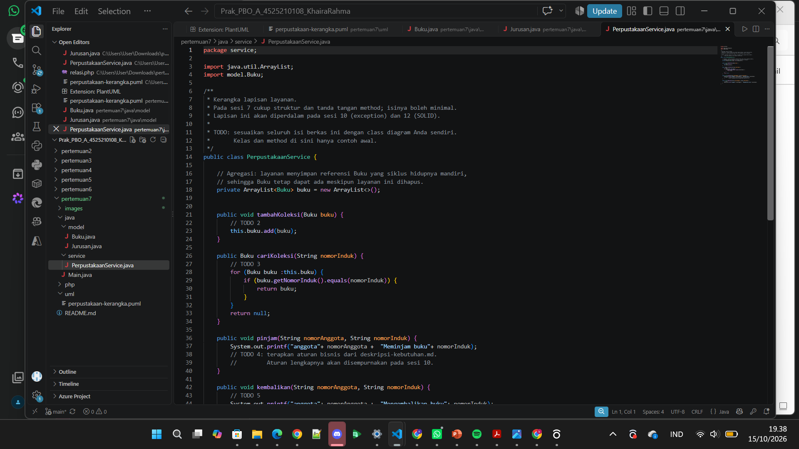

**Penjelasan kode:**

1. **Keputusan relasi (TODO 1): agregasi.** Komentar di kode menyatakan layanan menyimpan **referensi** `Buku` yang siklus hidupnya mandiri, sehingga `Buku` tetap ada meskipun layanan dihapus. Disimpan dalam `private ArrayList<Buku> buku = new ArrayList<>();`.
2. **`tambahKoleksi()` (TODO 2).** `this.buku.add(buku);` menerima objek `Buku` dari luar (ciri agregasi).
3. **`cariKoleksi()` (TODO 3).** Mengulang daftar `buku`, lalu mengembalikan `Buku` yang `getNomorInduk()`-nya sama dengan `nomorInduk`. Kalau tidak ada, mengembalikan `null`.
4. **`pinjam()` dan `kembalikan()` (TODO 4 dan 5).** Baru mencetak pesan peminjaman dan pengembalian, sesuai catatan bahwa aturan lengkapnya menyusul pada sesi 10.

---

# Bagian PHP

## File relasi.php (semua class)

Seluruh kelas ditaruh dalam satu berkas. PHP tidak punya *nested class* seperti Java, jadi sifat "hanya `Buku` yang boleh membuat `Bab`" dijaga lewat **konvensi**, bukan oleh bahasa.

### Sebelum

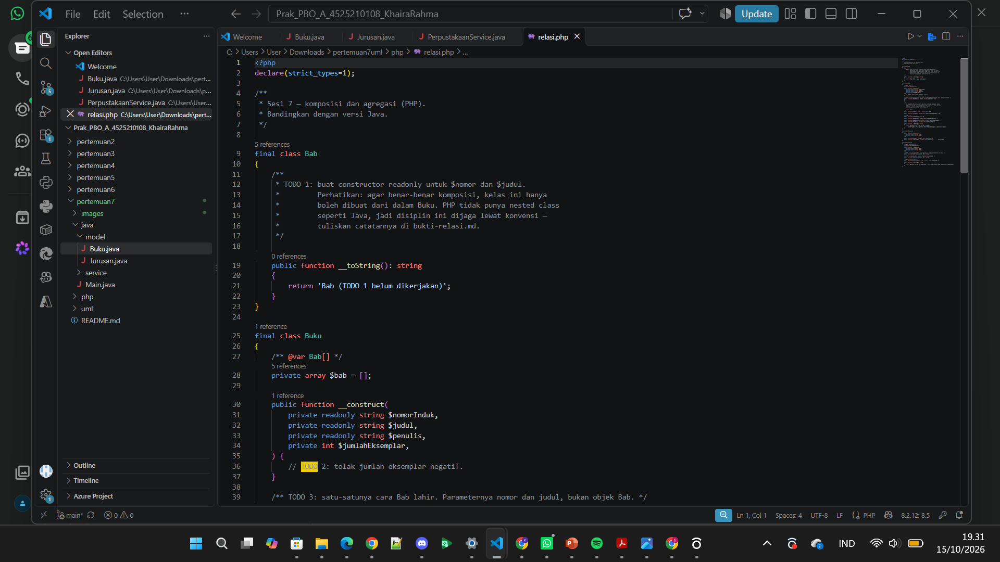

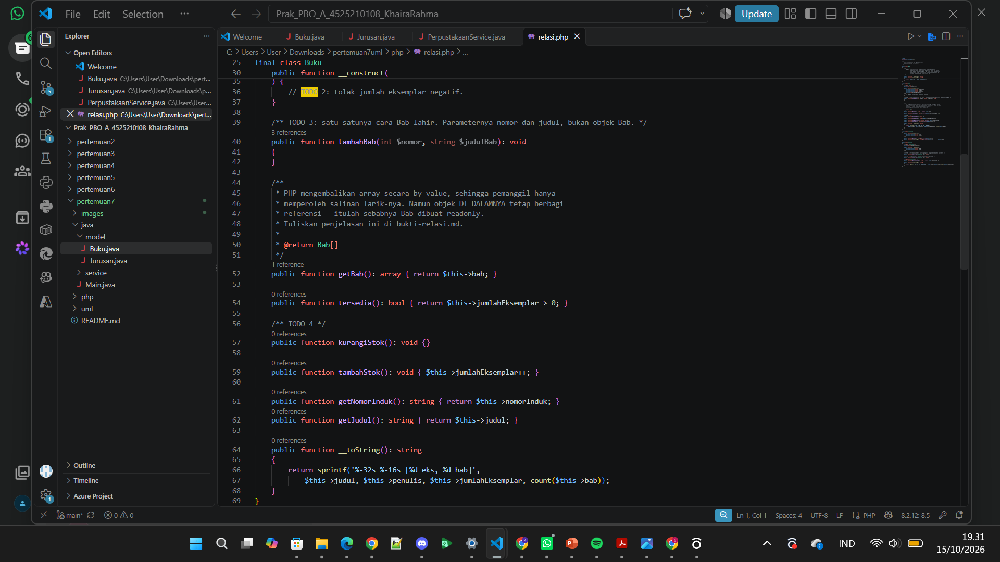

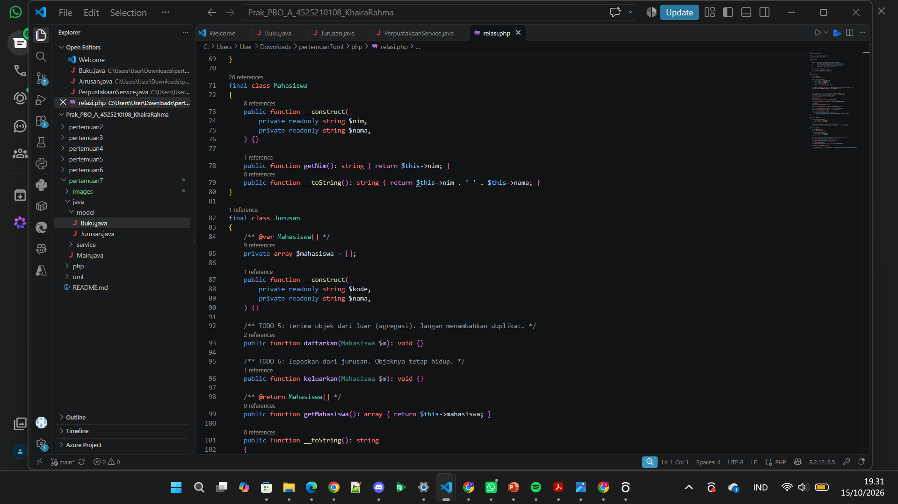

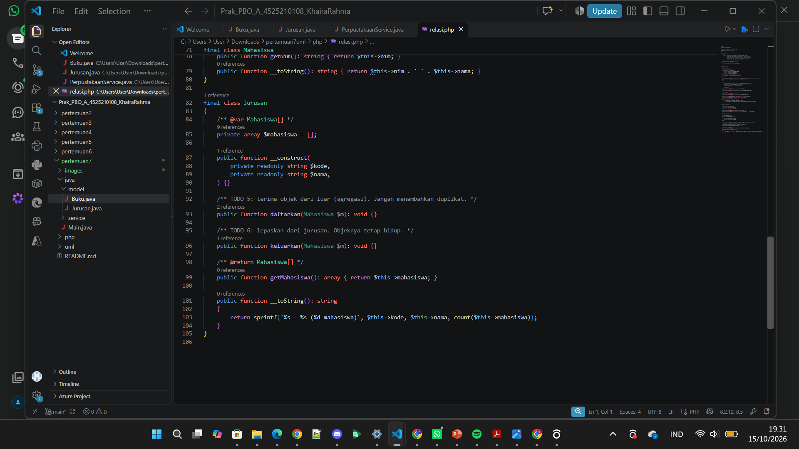

**Yang diminta:**

- **TODO 1**: constructor `readonly` untuk `$nomor` dan `$judul` di `Bab`. Agar benar-benar komposisi, kelas ini hanya boleh dibuat dari dalam `Buku`. Karena PHP tidak punya *nested class*, disiplin ini dijaga lewat konvensi, dan catatannya ditulis di `bukti-relasi.md`.
- **TODO 2**: constructor `Buku` menolak jumlah eksemplar negatif.
- **TODO 3**: `tambahBab(int $nomor, string $judulBab)` sebagai satu-satunya cara `Bab` lahir (nomor dan judul, bukan objek `Bab`).
- **Catatan `getBab()`**: PHP mengembalikan array **by-value**, sehingga pemanggil hanya memperoleh salinan larik-nya. Namun objek **di dalamnya** tetap berbagi referensi, itulah sebabnya `Bab` dibuat `readonly`. Penjelasannya ditulis di `bukti-relasi.md`.
- **TODO 4**: `kurangiStok()` (kurangi stok, tolak bila sudah nol).
- **TODO 5**: `Jurusan::daftarkan(Mahasiswa $m)` menerima objek dari luar (agregasi), jangan menambahkan duplikat.
- **TODO 6**: `Jurusan::keluarkan(Mahasiswa $m)` melepas dari jurusan, objeknya tetap hidup.

**Kondisi kode awal:** `Bab` baru punya `__toString()` sementara (`'Bab (TODO 1 belum dikerjakan)'`), constructor `Buku` belum punya validasi, dan `tambahBab()`, `kurangiStok()`, `daftarkan()`, serta `keluarkan()` masih kosong.

### Setelah

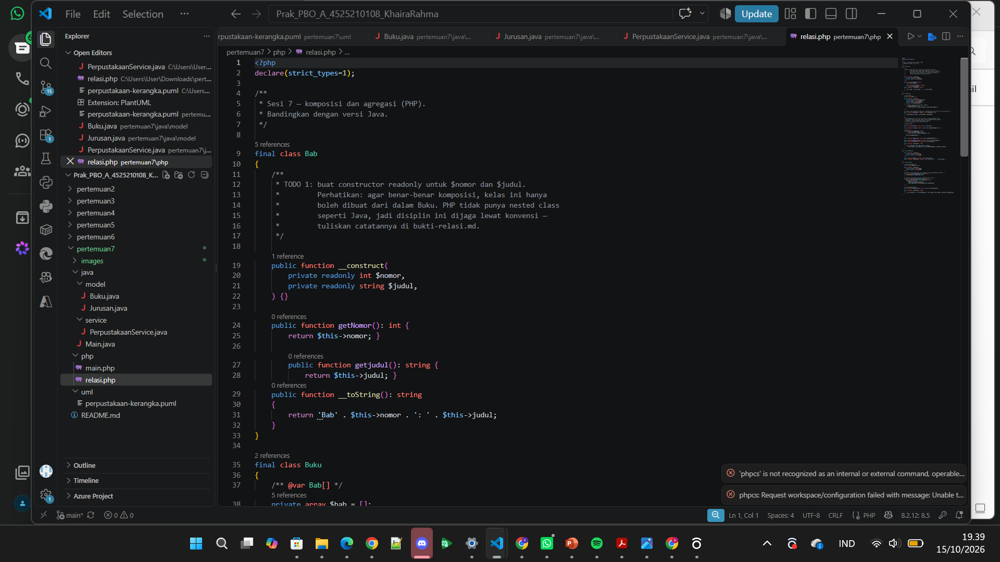

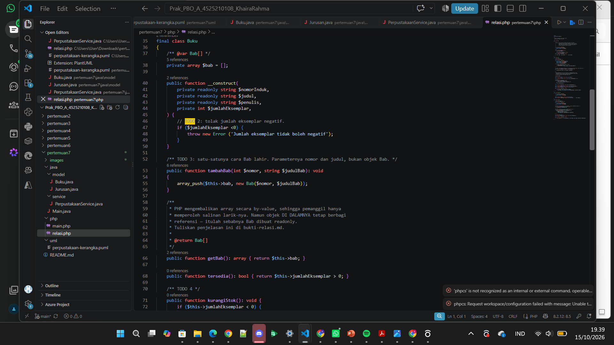

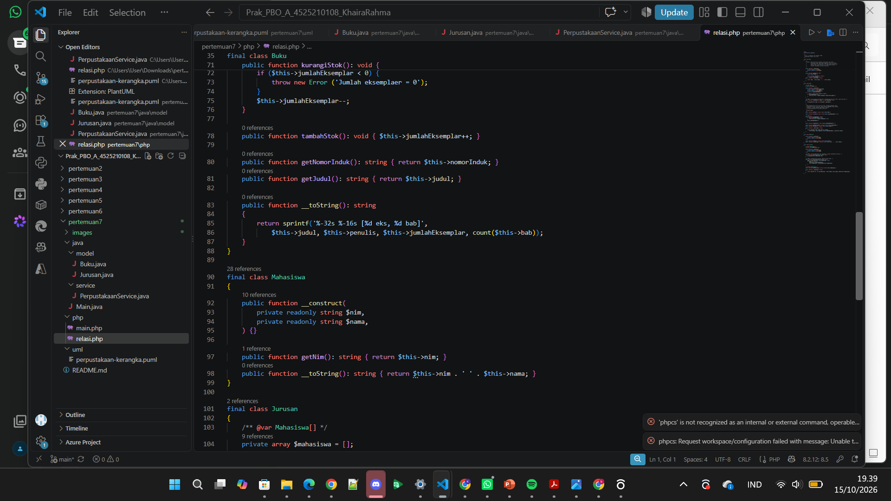

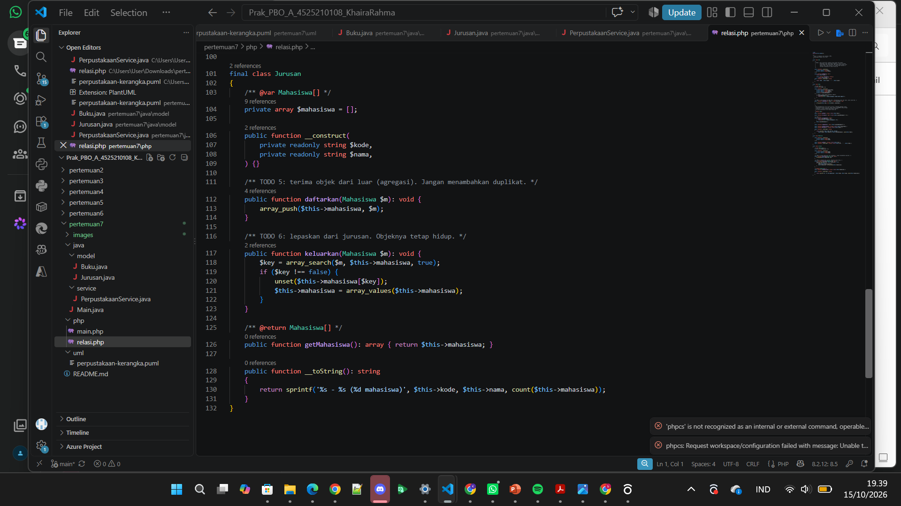

**Penjelasan kode:**

1. **`Bab` (TODO 1).** `final class Bab` dengan *constructor promotion* `private readonly int $nomor` dan `private readonly string $judul`, getter `getNomor()` dan `getjudul()`, serta `__toString()` yang menampilkan `Bab<nomor>: <judul>`. Karena `readonly`, objek `Bab` tidak bisa diubah setelah dibuat.
2. **Constructor `Buku` (TODO 2).** `if ($jumlahEksemplar < 0)` melempar `Error('Jumlah eksemplar tidak boleh negatif')`.
3. **`tambahBab()` (TODO 3).** `array_push($this->bab, new Bab($nomor, $judulBab));` membuat `Bab` **di dalam** `Buku`.
4. **`getBab()`** tetap `return $this->bab;`. Karena array dikembalikan by-value, pemanggil hanya mendapat salinan larik. Menambah elemen ke salinan itu tidak mengubah isi `Buku`, dan objek `Bab` di dalamnya aman karena `readonly`.
5. **`kurangiStok()` (TODO 4).** Memeriksa `$this->jumlahEksemplar` lalu melempar `Error('Jumlah eksemplar = 0')` sebelum `$this->jumlahEksemplar--;`.
6. **`Jurusan::daftarkan()` (TODO 5).** `array_push($this->mahasiswa, $m);` menerima objek `Mahasiswa` dari luar.
7. **`Jurusan::keluarkan()` (TODO 6).** `array_search($m, $this->mahasiswa, true)` mencari objek yang **identik** (`true` = pembanding ketat). Kalau ketemu, `unset(...)` lalu `array_values(...)` merapikan indeks. Objek `Mahasiswa` tidak ikut dihapus.
8. **`getMahasiswa()`** mengembalikan array (salinan by-value), dan `__toString()` menampilkan `kode - nama (N mahasiswa)`.

---

# Sistem Perpustakaan — Class Diagram (Sesi 7)

### sebelum
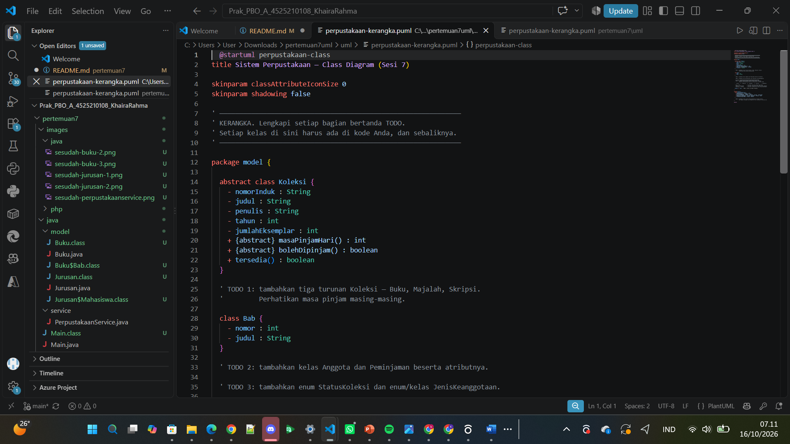
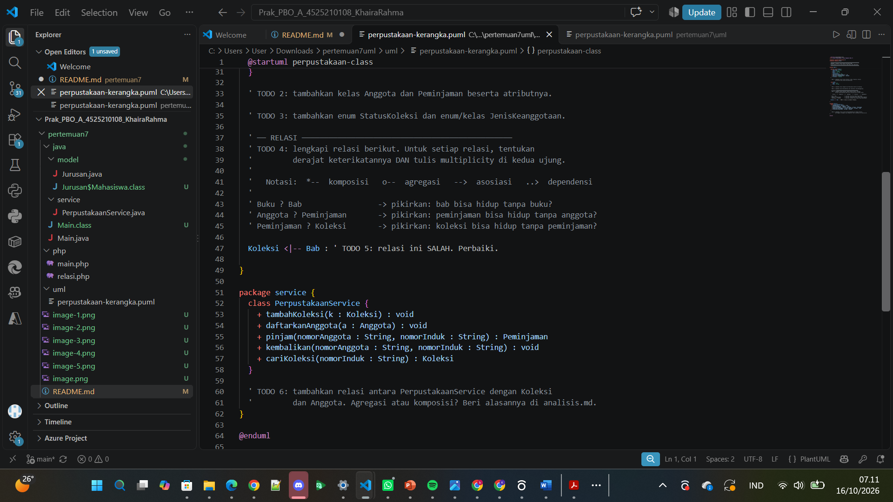

> Angka masa pinjam (14, 7, 0) dan atribut tambahan adalah **asumsi**. Sesuaikan dengan aturan di soal atau modul.


#### TODO 1: Turunan Koleksi

`Buku`, `Majalah`, dan `Skripsi` adalah *jenis* koleksi (hubungan **is-a**), jadi memakai pewarisan `<|--`. Karena `masaPinjamHari()` dan `bolehDipinjam()` abstrak, setiap turunan wajib meng-override keduanya.

| Kelas | `masaPinjamHari()` | `bolehDipinjam()` | Atribut tambahan |
|---|---|---|---|
| Buku | 14 | true | `isbn`, `bab : List<Bab>` |
| Majalah | 7 | true | `edisi` |
| Skripsi | 0 | false (baca di tempat) | `pembimbing` |

#### TODO 2: Anggota dan Peminjaman

- **Anggota**: `nomorAnggota : String`, `nama : String`, `jenis : JenisKeanggotaan`. Atribut `nomorAnggota` wajib ada karena `PerpustakaanService.pinjam()` mencari anggota dengan nomor itu.
- **Peminjaman**: `tanggalPinjam : LocalDate`, `tanggalJatuhTempo : LocalDate`, `tanggalKembali : LocalDate`. Jatuh tempo dihitung dari `tanggalPinjam + masaPinjamHari()` milik koleksi.

#### TODO 3: Enum

```plantuml
enum StatusKoleksi {
  TERSEDIA
  HABIS
  HANYA_BACA_DI_TEMPAT
}

enum JenisKeanggotaan {
  MAHASISWA
  DOSEN
  UMUM
}
```

- `StatusKoleksi` dipakai oleh `Koleksi`. Nilai `HANYA_BACA_DI_TEMPAT` cocok untuk `Skripsi`.
- `JenisKeanggotaan` dipakai oleh `Anggota`.
- Jika enum punya field (misalnya `batasPinjam`), tuliskan di dalam enum.

#### TODO 4: Tiga relasi

Pertanyaan penentu: **apakah bagian bisa hidup tanpa induknya?**

| Relasi | Jenis | Multiplicity | Alasan |
|---|---|---|---|
| Buku ↔ Bab | Komposisi `*--` | `1` ke `0..*` | Bab tidak bermakna tanpa buku, dibuat oleh `Buku`, ikut hilang bersamanya. |
| Anggota ↔ Peminjaman | Komposisi `*--` | `1` ke `0..*` | Peminjaman tidak punya arti tanpa anggota yang meminjam. |
| Peminjaman ↔ Koleksi | Asosiasi `-->` | `0..*` ke `1` | Koleksi tetap hidup walau tidak pernah dipinjam. `Peminjaman` hanya menyimpan referensi. |

```plantuml
Buku "1" *-- "0..*" Bab : memiliki
Anggota "1" *-- "0..*" Peminjaman : melakukan
Peminjaman "0..*" --> "1" Koleksi : meminjam
Anggota --> JenisKeanggotaan
Koleksi --> StatusKoleksi
```

#### TODO 5: `Koleksi <|-- Bab` itu salah

Pewarisan berarti "adalah sebuah". Bab **bukan** sebuah koleksi, ia **bagian dari** buku. Hubungan part-of dinyatakan dengan komposisi, bukan pewarisan.

Hapus baris yang salah, ganti dengan:

```plantuml
Koleksi <|-- Buku
Koleksi <|-- Majalah
Koleksi <|-- Skripsi
Buku "1" *-- "0..*" Bab : memiliki
```

#### TODO 6: PerpustakaanService

Pilih **agregasi**:

```plantuml
PerpustakaanService "1" o-- "0..*" Koleksi : menyimpan referensi
PerpustakaanService "1" o-- "0..*" Anggota : menyimpan referensi
PerpustakaanService ..> Peminjaman
```

### Setelah

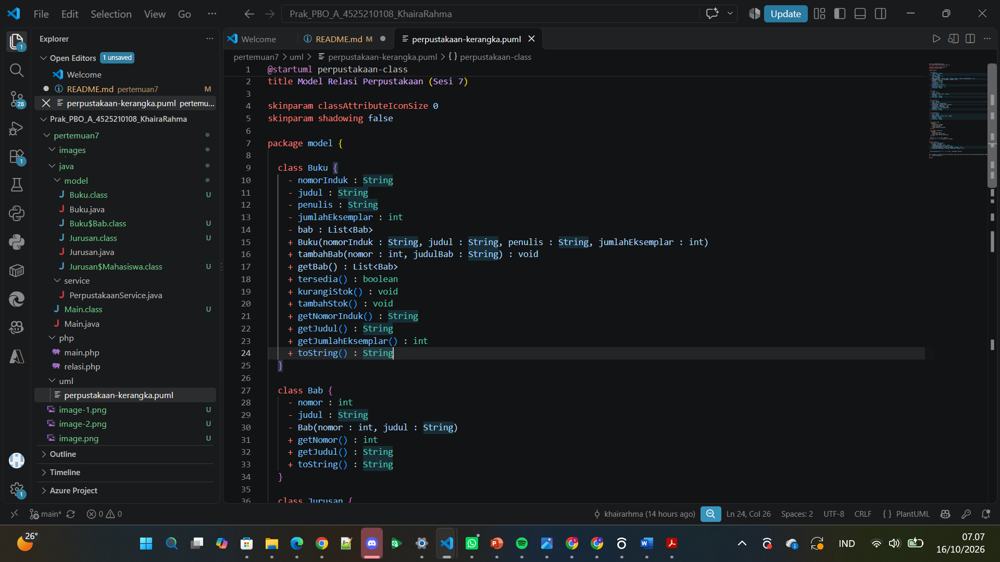
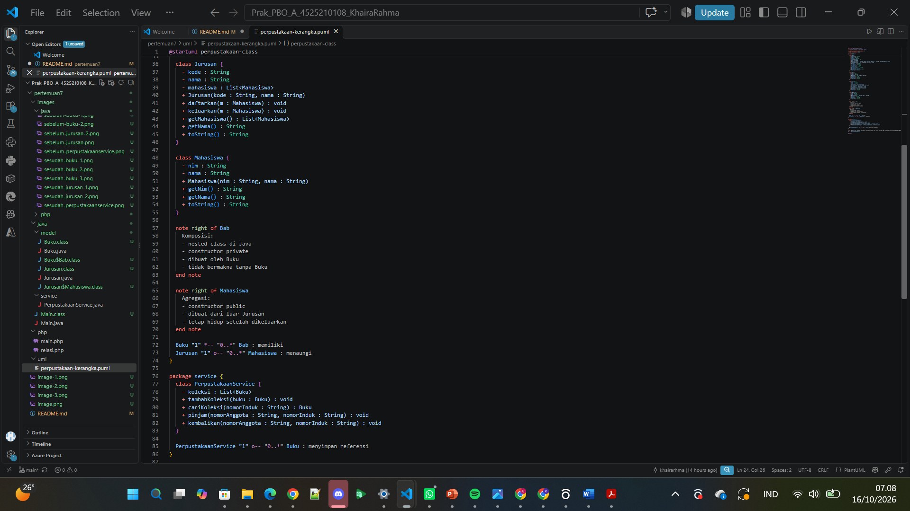

## SS Hasil keseluruhan (Terminal)

### Java

```
javac -d out model/*.java service/*.java Main.java
java -cp out Main
```

![Hasil terminal Java] 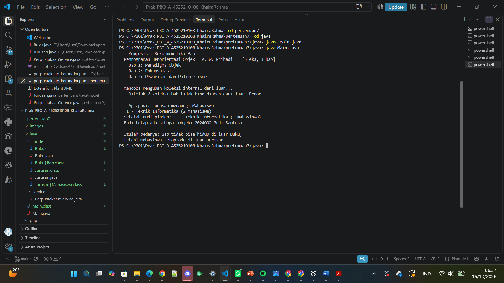

### PHP

```
php main.php
```

![Hasil terminal PHP] 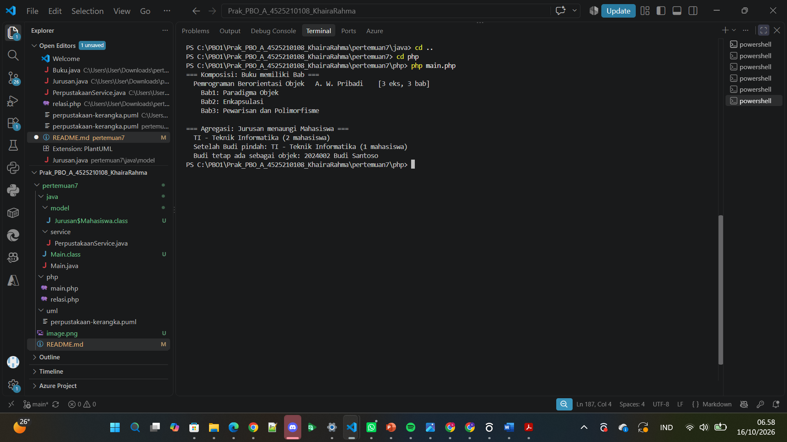

### uml
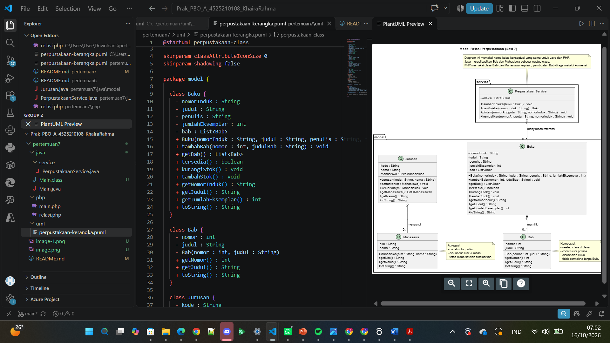

**Kesimpulan:**

1. **Komposisi** (`Buku` dan `Bab`): bagian lahir dan mati bersama induknya. Itu dijamin dengan tiga hal: tidak ada pintu masuk untuk objek `Bab` dari luar, `Bab` dibuat di dalam `Buku`, dan getter hanya memberi salinan.
2. **Agregasi** (`Jurusan` dan `Mahasiswa`, juga `PerpustakaanService` dan `Buku`): bagian dibuat di luar lalu diserahkan, sehingga tetap hidup walau induknya dilepas atau dihapus.
3. **Java vs PHP.** Java bisa memaksa komposisi lewat *nested class* dengan constructor `private`. PHP tidak punya nested class, jadi jaminannya berupa konvensi dan `readonly`.
4. **Salinan tak-berubah** (`List.copyOf` di Java, array by-value di PHP) melindungi isi induk dari perubahan lewat getter.
