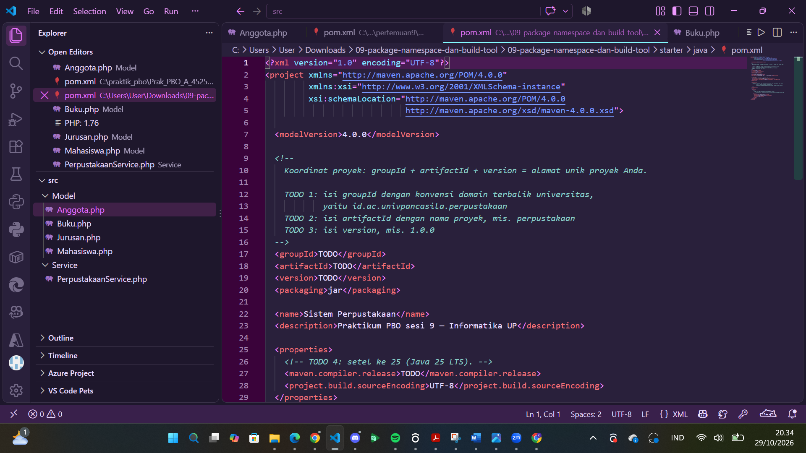
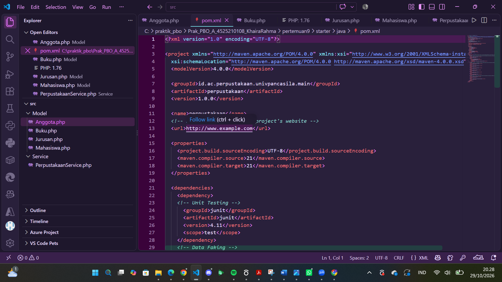
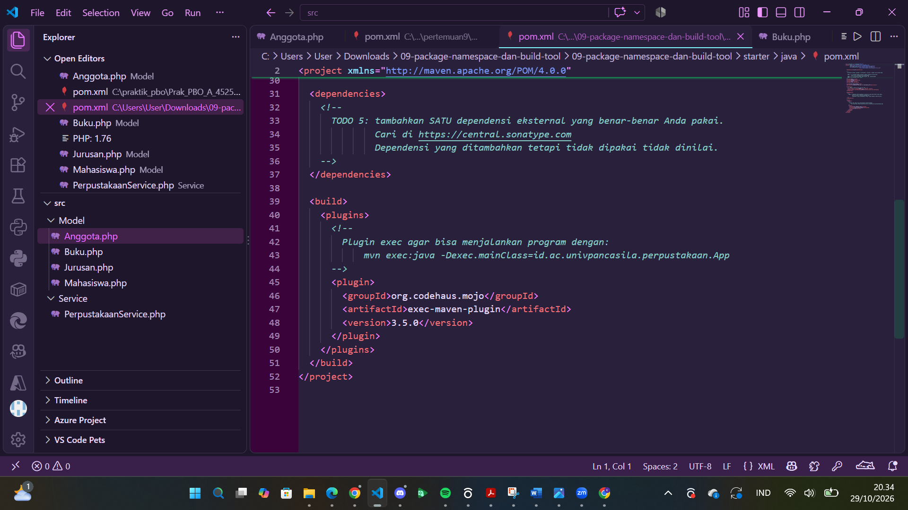
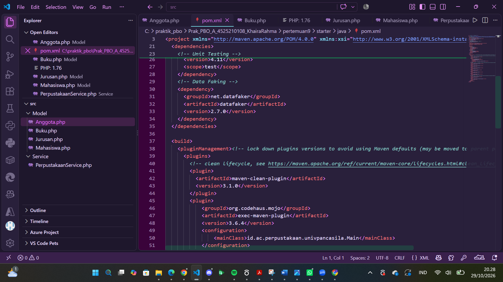
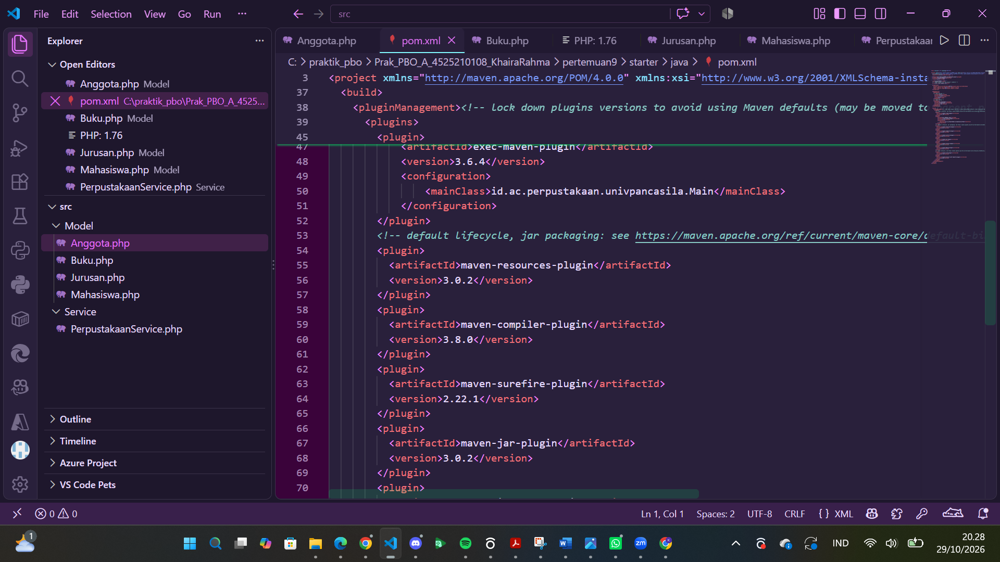
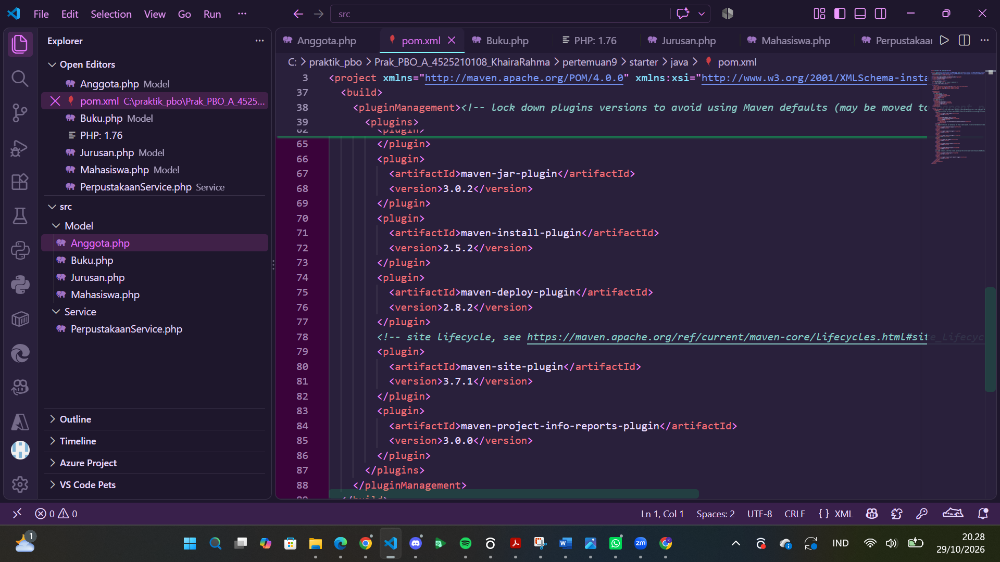
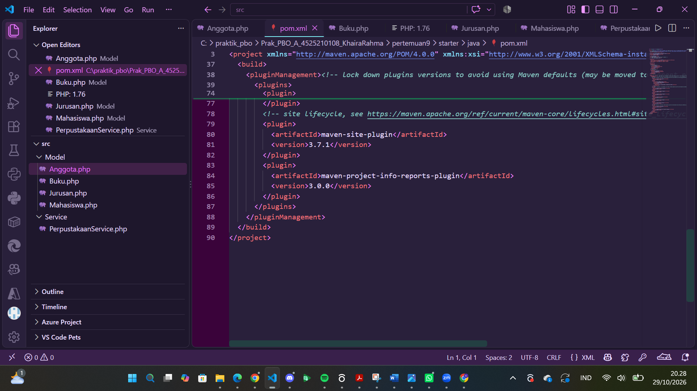
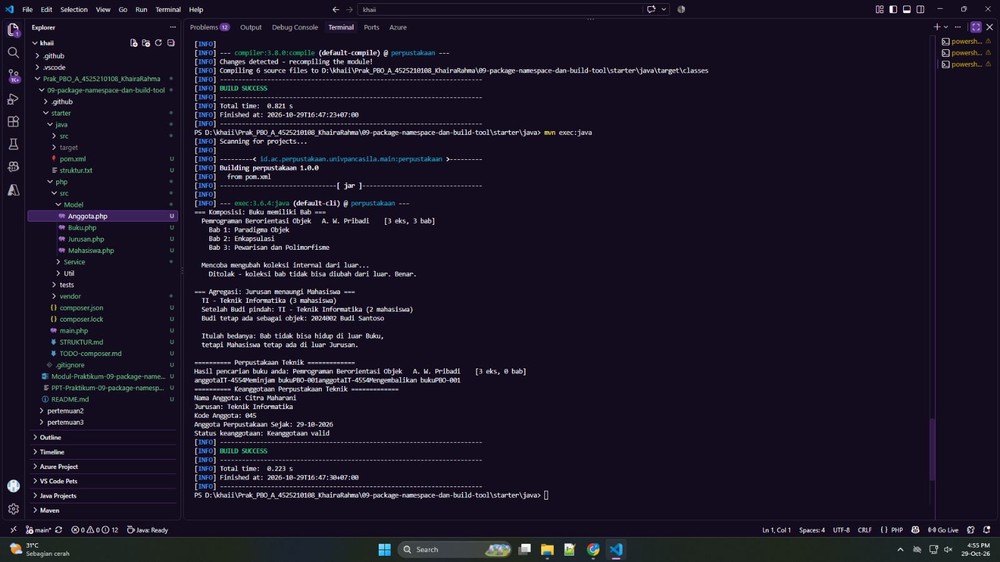
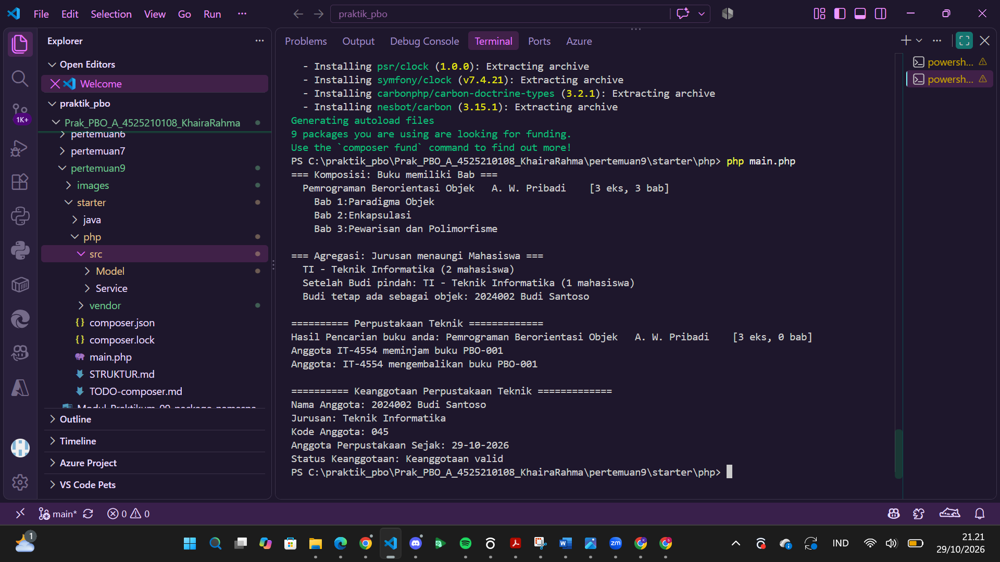

## Perubahan `pom.xml` per TODO: Sebelum dan Sesudah (Maven, Pertemuan 9)

### TODO 1-3: Koordinat proyek (`groupId`, `artifactId`, `version`)

**Sebelum**

**Sesudah**

| | Sebelum | Sesudah |
|---|---|---|
| `groupId` | `TODO` | `id.ac.perpustakaan.univpancasila.main` |
| `artifactId` | `TODO` | `perpustakaan` |
| `version` | `TODO` | `1.0.0` |

### TODO 4: Versi Java

**Sebelum**

**Sesudah**

| | Sebelum | Sesudah |
|---|---|---|
| Versi Java | `maven.compiler.release` = `TODO` | `maven.compiler.source` dan `maven.compiler.target` = `21` |

### TODO 5: Dependensi eksternal

**Sebelum**

**Sesudah**

| | Sebelum | Sesudah |
|---|---|---|
| `<dependencies>` | Kosong (hanya komentar TODO) | JUnit 4.11 (`scope test`) dan Datafaker 2.7.0 |

### Plugin build (`exec-maven-plugin`)

**Sebelum**

**Sesudah**

| | Sebelum | Sesudah |
|---|---|---|
| `exec-maven-plugin` | Versi 3.5.0, tanpa konfigurasi | Versi 3.6.4, dengan `mainClass` |
| Plugin lain | Tidak dikunci | Dikunci lewat `pluginManagement` |

## Java vs PHP: Cara Memakai Dependensi

| Aspek | Java (Maven) | PHP (Composer) |
|-------|--------------|----------------|
| Berkas konfigurasi | `pom.xml` (XML) | `composer.json` (JSON) |
| Identitas pustaka | `groupId` + `artifactId` + `version` | `vendor/package` + batasan versi |
| Pustaka data palsu | `net.datafaker:datafaker:2.7.0` | `fakerphp/faker` |
| Pustaka pengujian | `junit:junit:4.11` (`<scope>test</scope>`) | `phpunit/phpunit` (`require-dev`) |
| Repositori | Maven Central (`central.sonatype.com`) | Packagist (`packagist.org`) |
| Perintah pasang | `mvn install` (otomatis saat build) | `composer install` / `composer require ...` |
| Lokasi unduhan | `~/.m2/repository` (cache global) | folder `vendor/` di proyek |
| Pemuatan kelas | Classpath; `package` cocok dengan struktur folder | `namespace` + autoload PSR-4 (`vendor/autoload.php`) |
| Menjalankan program | `mvn exec:java` | `php main.php` atau `composer run` |
| Versi bahasa | `maven.compiler.release` | `"require": {"php": ">=8.1"}` |
| Dikompilasi? | Ya, lewat `maven-compiler-plugin` | Tidak, langsung ditafsirkan |

Pada Java, `<scope>test</scope>` membuat JUnit tidak ikut ke hasil build. Padanannya di PHP adalah `require-dev`, yang bisa dilewati dengan `composer install --no-dev`.

## Hasil Menjalankan Program

### Java (Maven)

Perintah: `mvn exec:java` dari folder `starter/java`. Build berhasil (`BUILD SUCCESS`) dan program menampilkan hasil komposisi, agregasi, serta layanan perpustakaan.

### PHP (Composer)

Perintah: `composer install` untuk memasang dependensi (termasuk `nesbot/carbon`), lalu `php main.php` dari folder `starter/php`.

## Kesimpulan

1. **`pom.xml` adalah pusat konfigurasi proyek Maven.** Koordinat proyek (`groupId`, `artifactId`, `version`), versi Java, dependensi, dan plugin build semuanya diatur di satu berkas. Pada starter, bagian ini masih `TODO`; setelah dikerjakan, proyek punya identitas yang jelas dan bisa dibangun dengan konsisten.
2. **Dependensi dikelola otomatis.** Cukup menulis `groupId`, `artifactId`, dan `version`, Maven mengunduh pustaka dari Maven Central. Pada proyek ini dipakai JUnit (`scope test`, tidak ikut ke hasil build) dan Datafaker untuk data palsu.
3. **Versi plugin sebaiknya dikunci.** Lewat `pluginManagement`, hasil build tidak berubah-ubah mengikuti versi bawaan Maven, dan `exec-maven-plugin` dengan `mainClass` memudahkan program dijalankan lewat `mvn exec:java`.
4. **Java dan PHP punya pola yang sama, alatnya berbeda.** Java memakai Maven (`pom.xml`, XML, classpath, dikompilasi), sedangkan PHP memakai Composer (`composer.json`, JSON, autoload PSR-4, langsung ditafsirkan). Padanan `scope test` di Java adalah `require-dev` di PHP.
5. **Pengelola dependensi membuat proyek mudah direproduksi.** Siapa pun yang mengambil proyek cukup menjalankan `mvn install` (Java) atau `composer install` (PHP) tanpa mengunduh pustaka secara manual.
